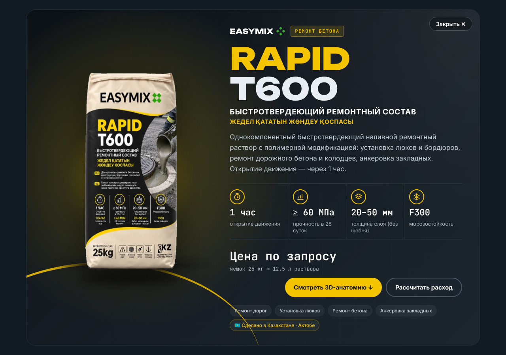
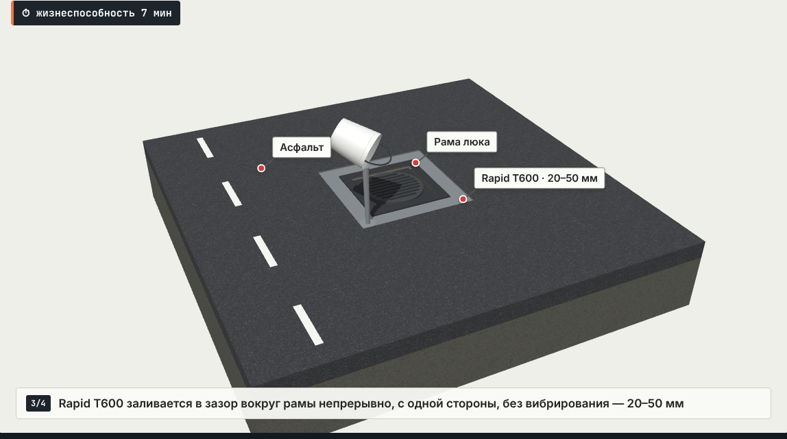
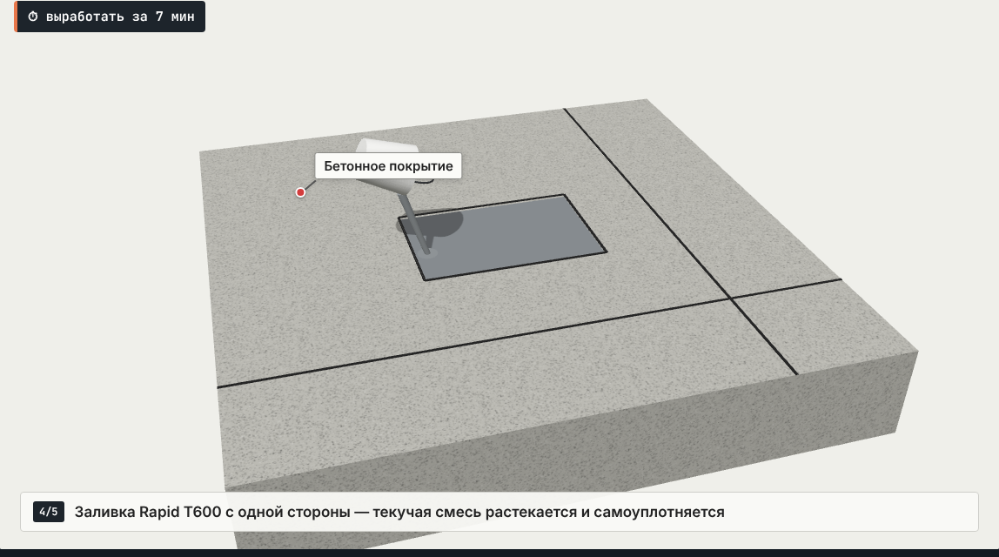
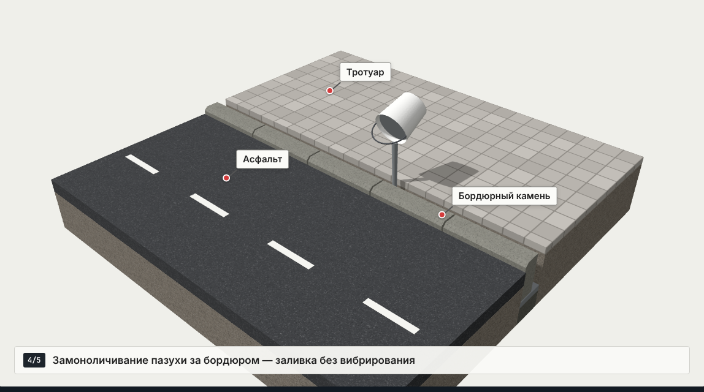
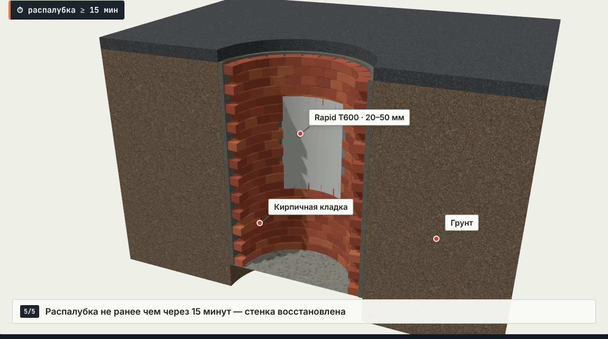
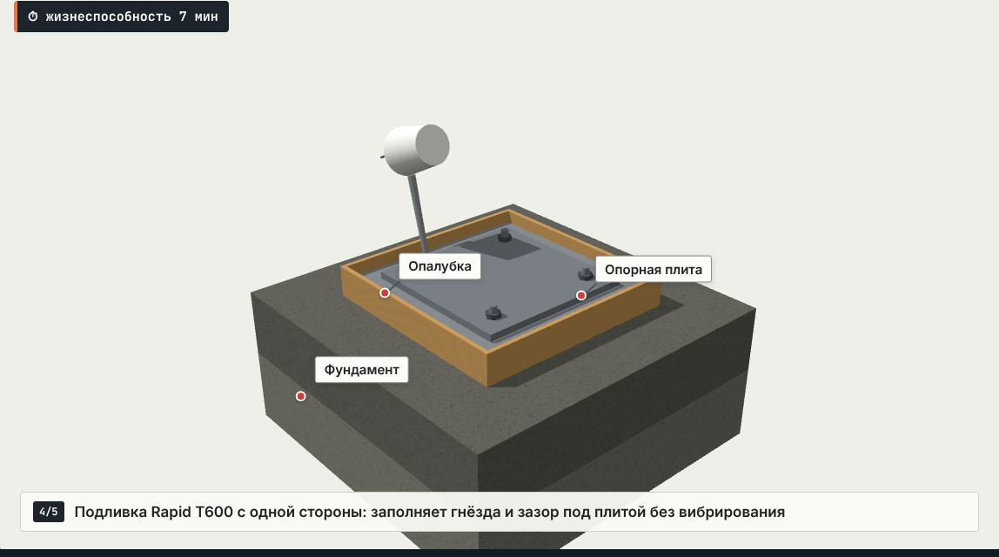
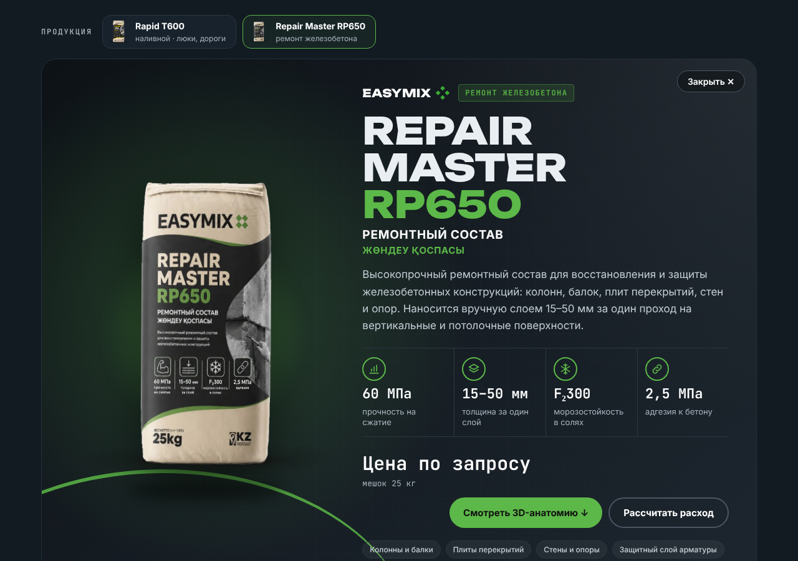
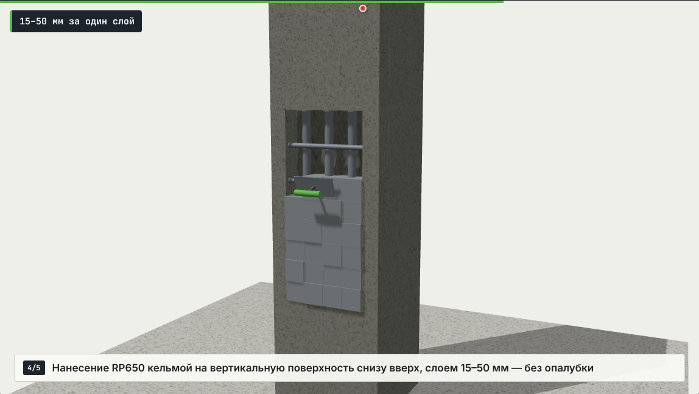
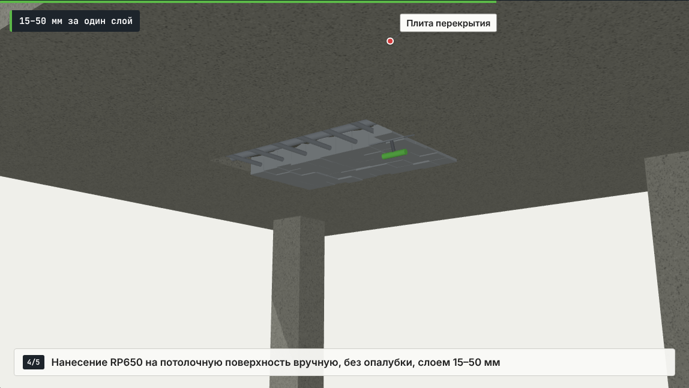
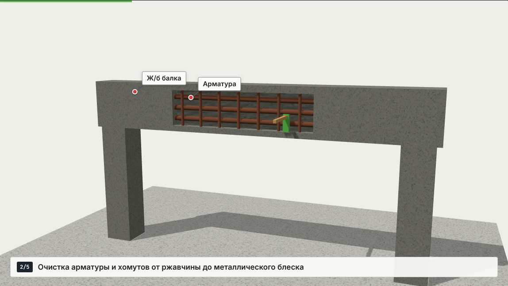

# EasyMix — 3D-анатомия применения

Продукты: **Rapid T600** (наливной быстротвердеющий) и **Repair Master RP650** (ремонт железобетона). Переключатель продуктов вверху страницы; ссылки вида `index.html#t600/manhole`, `index.html#rp650/column`.

## Rapid T600

Интерактивные 3D-анимации «как и куда наносить» (Three.js), один файл `index.html`.

## Сценарии (вкладки)

| Вкладка | Ссылка | Шаги |
| --- | --- | --- |
| Люк на дороге | `index.html#manhole` | вырубка → рама в проектное положение + увлажнение → заливка 20–50 мм → движение через 1 ч |
| Ремонт дорожного бетона | `index.html#patch` | пропил алмазным диском ≥ 20 мм → удаление бетона → увлажнение → заливка с одной стороны → движение через 1 ч |
| Бордюрный камень | `index.html#curb` | увлажнение траншеи → подстилающий слой → установка по шнуру → замоноличивание пазухи → нагрузка через 1 ч |
| Стенка колодца | `index.html#shaft` | удаление кладки → увлажнение → опалубка → заливка и шуровка → распалубка ≥ 15 мин |
| Анкеровка закладных | `index.html#anchor` | увлажнение гнёзд → анкеры и плита на гайках → опалубка → подливка → монтаж колонны через 1 ч |

## Repair Master RP650

| Вкладка | Ссылка | Шаги |
| --- | --- | --- |
| Колонна | `#rp650/column` | удаление бетона → очистка арматуры → увлажнение → нанесение кельмой 15–50 мм → заглаживание |
| Плита перекрытия (потолок) | `#rp650/ceiling` | то же снизу, по потолку, без опалубки |
| Балка / ригель | `#rp650/beam` | то же на боковой грани балки |

⚠ Для RP650 расход в калькуляторе (≈ 20 кг/м² на 10 мм) — ориентировочный; уточните по техописанию (`calc` в настройках продукта).

Плюс блок ключевых характеристик и калькулятор расхода (20 кг/м² на 10 мм, щебень для слоя > 50 мм).

Управление: «Интерактивный 3D» — вращение/масштаб, «Пауза», клик по шагу — переход к нему.

Баннер с фото мешка (`assets/rapid-t600-bag.webp`, фон вырезан). Все тексты (название, описание, цена, шаги, плашки, характеристики, контакты) — в массиве `window.PRODUCTS` в начале `index.html` (по объекту на продукт).

Запуск: открыть `index.html` в браузере (нужен интернет для Three.js с CDN и шрифтов).

